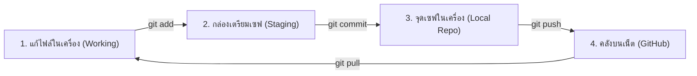

# คู่มือคำสั่ง Git & GitHub ฉบับพกพา (Git & GitHub Cheat Sheet)

> **เอาไว้ใช้กับทุกโปรเจกต์ได้เลย** — ใช้ได้ทั้งใน Windows (`cmd` / PowerShell) และ Mac/Linux  
> *(คำสั่งด้านล่างใช้เครื่องหมายคำพูดคู่ `"..."` เพื่อให้รันได้ชัวร์ทั้งใน `cmd` และ PowerShell)*

---

## 1. ภาพรวมการทำงานของ Git (จำแค่ 4 ขั้นนี้!)



- **Git** = ระบบบันทึกจุดเซฟโค้ดในเครื่องเรา (เหมือนเซฟเกม ย้อนเวลากลับได้)
- **GitHub** = เว็บคลาวด์เอาไว้เก็บโค้ด แชร์กับทีม และจัดการใบงาน (Issues / Pull Request)

---

## 2. สูตรเริ่มโปรเจกต์ใหม่ & เอาขึ้น GitHub (Start a New Project)

### กรณี A: สร้างโปรเจกต์ใหม่ในเครื่อง แล้วอยากเอาขึ้น GitHub
```cmd
cd <โฟลเดอร์โปรเจกต์ของคุณ>
git init
git branch -M main
git add .
git commit -m "feat: initialize project"
gh repo create <ชื่อโปรเจกต์> --public --source=. --remote=origin --push
```
- ถ้าอยากให้ Repo เป็นส่วนตัว (เห็นคนเดียว) ให้เปลี่ยน `--public` เป็น `--private`
- **อย่าลืมสร้างไฟล์ `.gitignore` ก่อน `git add .`** เพื่อกันไม่ให้ไฟล์รหัสผ่าน (`.env`) หรือไฟล์ขยะถูกส่งขึ้น GitHub

### กรณี B: ดึงโปรเจกต์ที่มีอยู่แล้วบน GitHub ลงมาทำในเครื่อง
```cmd
git clone https://github.com/<ชื่อผู้ใช้>/<ชื่อโปรเจกต์>.git
cd <ชื่อโปรเจกต์>
```

---

## 3. คำสั่งที่ใช้ทุกวัน (Daily Commands)

| คำสั่ง | ทำหน้าที่อะไร |
|---|---|
| `git status` | **เช็กสถานะไฟล์ทั้งหมด** (พิมพ์บ่อยๆ ได้เลย ไม่มีทางพัง! ดูว่าแก้ไฟล์ไหนไปแล้วบ้าง) |
| `git diff` | ดูรายละเอียดว่าแต่ละไฟล์แก้บรรทัดไหน เพิ่ม/ลบอะไรไปบ้าง |
| `git add <ชื่อไฟล์>` | หยิบเฉพาะไฟล์ที่ต้องการใส่กล่องเตรียมเซฟ |
| `git add .` | หยิบไฟล์ที่แก้ทั้งหมดใส่กล่องเตรียมเซฟ |
| `git commit -m "ข้อความ"` | กดเซฟจุดบันทึก พร้อมข้อความอธิบายว่าแก้อะไร |
| `git push` | ส่งจุดเซฟจากเครื่องขึ้นไปบน GitHub |
| `git pull` | ดึงโค้ดอัปเดตล่าสุดจาก GitHub ลงมาที่เครื่อง |
| `git log --oneline -n 10` | ดูประวัติการ Commit ล่าสุด 10 ครั้งแบบย่อ |

---

## 4. สูตรแตก Branch & เปิด Pull Request แบบทีมทำงานจริง

เวลาเพิ่มฟีเจอร์ใหม่หรือแก้บั๊ก **เราจะไม่แก้ตรงๆ บน `main`** แต่จะแยกกิ่ง (`Branch`) ออกมาทำก่อน พอเสร็จค่อยขอรวมกลับ (`Pull Request`)

```cmd
:: 1. ดึงโค้ดล่าสุดที่ main ก่อนเริ่มงานเสมอ
git checkout main
git pull

:: 2. สร้างกิ่งใหม่แล้วย้ายไปทำในกิ่งนั้น
git checkout -b feat/menu-screen

:: 3. เขียนโค้ดเสร็จแล้ว เช็กสถานะ -> add -> commit
git status
git add .
git commit -m "feat: add drink menu screen"

:: 4. ส่งกิ่งใหม่ขึ้น GitHub (ครั้งแรกใช้ -u)
git push -u origin feat/menu-screen

:: 5. เปิด Pull Request (PR) ขอรวมโค้ดเข้า main
gh pr create --title "feat: add drink menu screen" --body "Closes #1"

:: 6. เมื่อรีวิวผ่านและรวมโค้ดแล้ว ย้ายกลับ main และดึงของล่าสุดลงเครื่อง
git checkout main
git pull
```

**คำสั่งดู/สลับ Branch ที่ใช้บ่อย:**
- `git branch` — ดูว่ามีกิ่งอะไรบ้าง (ตัวที่มี `*` คือที่เราอยู่ตอนนี้)
- `git checkout <ชื่อกิ่ง>` — ย้ายไปกิ่งที่มีอยู่แล้ว
- `git branch -d <ชื่อกิ่ง>` — ลบกิ่งเก่าในเครื่องที่รวมเข้า `main` ไปแล้ว

---

## 5. สูตรจัดการใบงานบน GitHub ด้วย `gh` (Issues & Labels)

| คำสั่ง | ความหมาย |
|---|---|
| `gh label create "ชื่อป้าย" --color "02569B" --description "คำอธิบาย"` | สร้างป้ายสีแยกหมวดหมู่ (`color` เป็นรหัสสี Hex ไม่ต้องใส่ `#`) |
| `gh issue create --title "หัวข้องาน" --label "ชื่อป้าย" --body "รายละเอียด"` | สร้างใบงานใหม่ (Feature หรือ Bug Report) |
| `gh issue list` | ดูใบงานทั้งหมดที่ยังเปิดอยู่ |
| `gh issue view 1` | อ่านรายละเอียดใบงานหมายเลข `#1` |
| `gh issue close 1` | ปิดใบงานหมายเลข `#1` เมื่อทำเสร็จแล้ว |
| `gh repo view --web` | เปิดหน้า Repo บนเว็บเบราว์เซอร์ทันที! |

> **ทริกเด็ดของคนทำงานจริง:** ถ้าในรายละเอียด Pull Request เขียนว่า `Closes #1` พอกด Merge PR ปุ๊บ GitHub จะปิดใบงาน `#1` ให้อัตโนมัติเลย!

---

## 6. สูตรตั้งชื่อ Commit Message แบบมืออาชีพ (Conventional Commits)

โครงสร้าง: **`<ประเภท>: <กริยาช่อง 1> <สิ่งที่ทำ>`** *(ไม่เติม `-ed` หรือ `-ing`)*

| ประเภท | ใช้เมื่อไหร่ | ตัวอย่าง Commit Message |
|---|---|---|
| `feat:` | เพิ่มฟีเจอร์ใหม่ | `feat: add drink customization options` |
| `fix:` | แก้บั๊ก | `fix: prevent negative total with promo code` |
| `docs:` | แก้เอกสาร / README / Note | `docs: add Git and GitHub cheat sheet` |
| `style:` | ปรับสี/การจัดวาง (ไม่เปลี่ยนการทำงาน) | `style: improve menu card spacing` |
| `test:` | เพิ่มหรือแก้ Test Case / โค้ดเทส | `test: add unit test for promo calculation` |
| `chore:` | งานตั้งค่าโปรเจกต์ / ลงแพ็กเกจ | `chore: update .gitignore rules` |

**คำกริยาภาษาอังกฤษยอดฮิต (จำแค่ 6 คำนี้ใช้ได้เกือบทั้งชีวิต Dev!):**
- `add` (เพิ่ม) | `fix` (แก้บั๊ก) | `update` (อัปเดต/ปรับปรุง) | `remove` (ลบออก) | `rename` (เปลี่ยนชื่อ) | `refactor` (จัดระเบียบโค้ดให้สวยขึ้น)

---

## 7. ปุ่มกู้ชีพเวลาทำพลาด (Undo & Check)

| สถานการณ์ที่พลาด | คำสั่งแก้ |
|---|---|
| งงว่าตอนนี้ทำอะไรค้างอยู่ / อยู่กิ่งไหน | `git status` และ `git branch` |
| เผลอ `git add` ผิดไฟล์ (ยังไม่ commit) | `git restore --staged <ชื่อไฟล์>` |
| แก้ไฟล์เละ อยากล้างกลับไปเหมือนตอน commit ล่าสุด | `git restore <ชื่อไฟล์>` *(ระวัง: สิ่งที่เพิ่งแก้ในไฟล์นั้นจะหาย)* |
| พิมพ์ข้อความ commit ล่าสุดผิด (ยังไม่ push) | `git commit --amend -m "ข้อความใหม่ที่ถูกต้อง"` |
| ลืมว่าผูก GitHub ไว้ที่ลิงก์ไหน | `git remote -v` |

---

## 8. รวมคำศัพท์ Git & GitHub ที่เจอบ่อย (Glossary)

| คำศัพท์ | คำอ่าน | ความหมายแบบจำง่าย |
|---|---|---|
| **Repository (Repo)** | รี-พอ-ซิ-ทอ-รี | โฟลเดอร์คลังเก็บโค้ดและประวัติทั้งหมดของโปรเจกต์ |
| **Commit** | คอม-มิต | จุดเซฟของโค้ด (เหมือน Save Point ในเกม) |
| **Branch** | บรานช์ | กิ่งแยกของโค้ด เอาไว้ทำฟีเจอร์ใหม่โดยไม่ทำ `main` พัง |
| **Pull Request (PR)** | พูล รี-เควสต์ | คำขอรวมโค้ดจากกิ่งย่อยเข้า `main` เพื่อให้เพื่อนช่วยตรวจก่อน |
| **Merge** | เมิร์จ | การรวมโค้ดจากกิ่งหนึ่งเข้ากับอีกกิ่งหนึ่ง |
| **Conflict** | คอน-ฟลิกต์ | โค้ดชนกัน (2 คนแก้บรรทัดเดียวกัน ต้องเลือกเก็บว่าจะเอาของใคร) |
| **Clone** | โคลน | ก๊อปปี้โปรเจกต์จาก GitHub ลงมาที่เครื่อง |
| **Issue** | อิช-ชู | ใบงานบน GitHub (ใช้จดฟีเจอร์ที่ต้องทำ หรือรายงานบั๊ก) |
