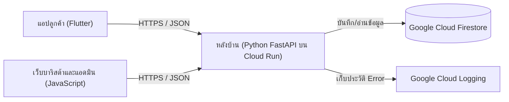

# แผนสร้างระบบร้าน TANUKI Cafe (PRD & Architecture)

## Phase 0: ความต้องการของระบบ (PRD)

### 1. ผู้ใช้งานในระบบ (Roles)
- **ลูกค้า (Customer):** ใช้งานผ่านแอป Flutter (`mobile_flutter/`) — ดูเมนู, เลือกร้อน/เย็น (+10 บาท), เลือกความหวาน (0%/50%/100%), ใส่โค้ดส่วนลด, สั่งซื้อ
- **บาริสต้า (Barista):** ใช้งานผ่านหน้าเว็บ JavaScript (`web_js/`) — ดูออเดอร์ใหม่และเปลี่ยนสถานะ (`Pending` -> `Preparing` -> `Ready`)
- **แอดมิน (Admin):** ใช้งานผ่านหน้าเว็บ JavaScript (`web_js/`) — สร้างโค้ดส่วนลดเองจากแทมเพลต 3 แบบ

### 2. เมนูและราคาเริ่มต้น (10 เมนู)
**กฎราคา:** แบบร้อน = ราคาปกติ | แบบเย็น = +10 บาท | ความหวาน = `0%`, `50%`, `100%` | ยอดสุทธิต่ำสุด = `0 บาท` (ห้ามติดลบ)

| หมวดหมู่ | ชื่อเมนู | ร้อน (บาท) | เย็น (บาท) |
|---|---|---:|---:|
| Coffee (กาแฟ) | Espresso | 50 | 60 |
| Coffee (กาแฟ) | Americano | 55 | 65 |
| Coffee (กาแฟ) | Cafe Latte | 65 | 75 |
| Coffee (กาแฟ) | Cappuccino | 65 | 75 |
| Milk (นม) | Fresh Milk | 50 | 60 |
| Milk (นม) | Caramel Milk | 60 | 70 |
| Milk (นม) | Cocoa Milk | 60 | 70 |
| Tea (ชา) | Thai Milk Tea | 55 | 65 |
| Tea (ชา) | Peach Tea | 55 | 65 |
| Tea (ชา) | Matcha Latte | 70 | 80 |

### 3. แทมเพลตโค้ดส่วนลดสำหรับแอดมิน (Promo Templates)
1. **ลดเป็นจำนวนเงิน + มีขั้นต่ำ (`FIXED_AMOUNT`):** เช่น `TANUKI20` ลด 20 บาท เมื่อสั่งครบ 100 บาท
2. **ลดเป็นเปอร์เซ็นต์ + จำกัดส่วนลดสูงสุด (`PERCENTAGE`):** เช่น `HAPPY15` ลด 15% สูงสุดไม่เกิน 50 บาท เมื่อสั่งครบ 120 บาท
3. **คูปองเงินสด ไม่มีขั้นต่ำ (`FLAT_VOUCHER`):** เช่น `CAFE50` ลด 50 บาททันที (ยอดต่ำสุดคือ 0 บาท ห้ามติดลบ)

---

## Phase 1: โครงสร้างระบบ (Architecture)

### API Endpoints (Milestone 4)
- `GET /api/menu` — ดึงรายการเมนูและราคา
- `POST /api/promos/validate` — ตรวจความถูกต้องของโค้ดส่วนลด
- `POST /api/orders` — ส่งคำสั่งซื้อใหม่
- `GET /api/orders` — ดึงรายการออเดอร์สำหรับบาริสต้า
- `PATCH /api/orders/{id}/status` — อัปเดตสถานะออเดอร์
- `POST /api/admin/promos` — แอดมินสร้างโค้ดส่วนลดใหม่จากแทมเพลต
